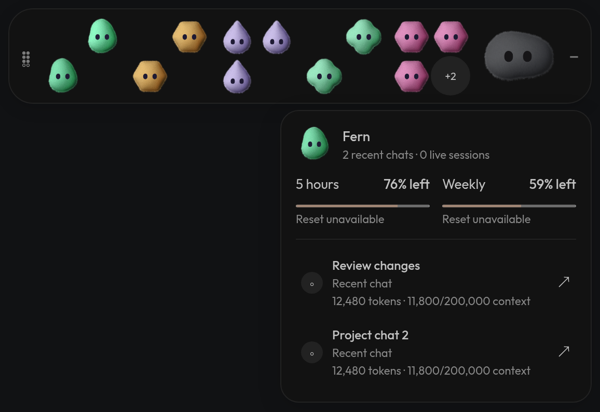
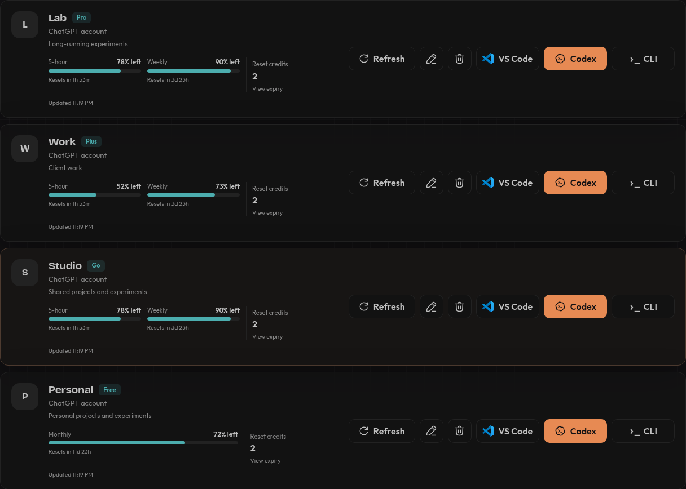

# Multi Codex

Manage Codex accounts across VS Code, the Codex app, and CLI while keeping your default login untouched. T3 Code desktop is also available on Linux and Windows.

[Read the full changelog and release details on the website](https://multi-codex.vercel.app/releases). GitHub hosts the downloadable packages.

## Orbit

Orbit keeps your accounts in view with a permanent companion for each account: an **Orbiter**. Each account keeps two recent Desktop chat shortcuts available while idle. Click to open the exact conversation in that account’s app. VS Code window shortcuts remain available. Two shortcuts use diagonal mini avatars; additional sessions stay reachable through the corners and overflow. Idle avatars are still, working uses a small optional status-dot pulse, and attention reminders use a static icon. Hover for usage and session details.

Enable or disable Orbit in **Settings**, and adjust size, display, animation and sound under **Orbit**. Available on Apple Silicon macOS 26+ and supported Linux desktops (Hyprland, GNOME and KDE). Closing the launcher keeps Orbit and the tray running; choosing Quit exits them.

## Install

[Install Multi Codex](https://multi-codex.vercel.app/install)

One link for Linux x64, Windows x64 and Apple Silicon Macs on macOS 26+. It suggests the right download and shows the setup steps. You can choose another computer on the same page, including when opening the link on your phone.

All supported platforms use stable v1.8.4. T3 Code launching is available on Linux and Windows; Mac gets the standard launcher without T3.

Codex Desktop opens directly without a project-folder picker. VS Code and CLI still let you choose their project folder.

## Update

Use the launcher’s **Update** button. **Settings → Launch settings → Release channel** chooses Stable updates or All updates, including previews. For a manual update, use the same install link above and close Multi Codex before running the installer or replacing the AppImage. Saved accounts and profile data are preserved.

Multi Codex is independent and is not affiliated with or endorsed by OpenAI.

## Command-line interface

Install the tested Linux x64 CLI with `npm install --global @russeldp/multi-codex` (Node.js 22.22.2+ and glibc 2.39+). The command is `multi-codex`. macOS ARM64 and Linux ARM64 definitions remain unpublished pending native verification. Source, command reference and packaging live in [cli/](cli/README.md); the CLI reuses the desktop launcher’s Rust account services.
