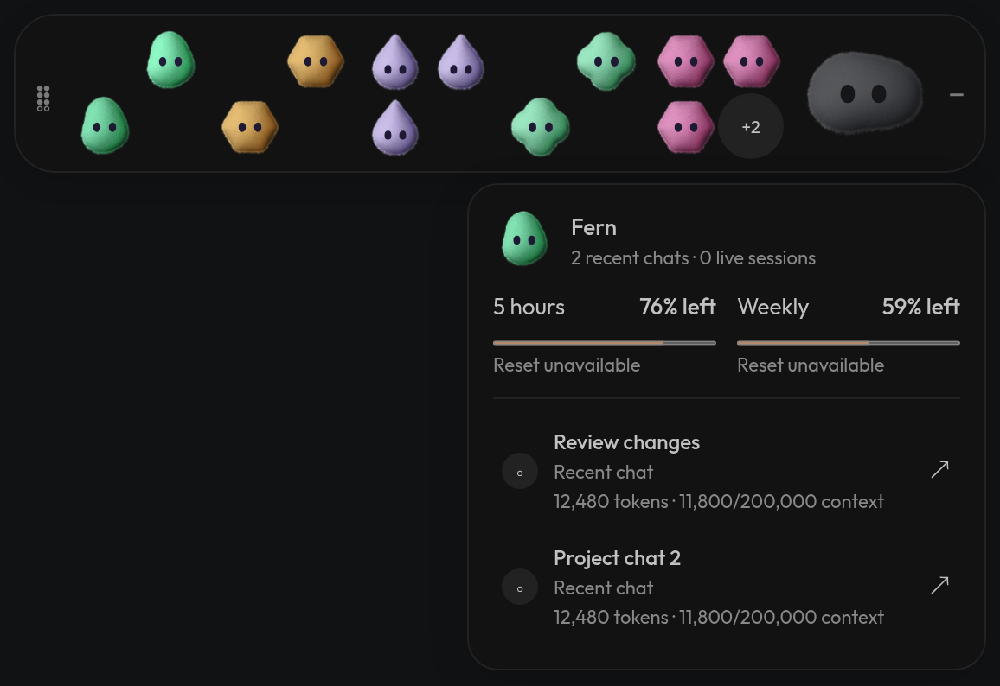
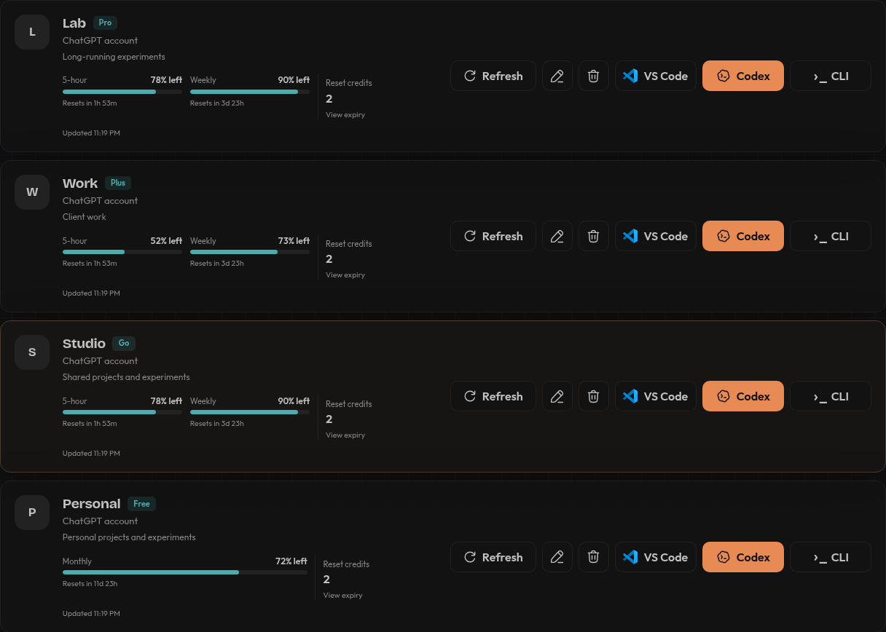

# Multi Codex

Manage Codex accounts across VS Code, the Codex app, and CLI while keeping your default login untouched.

[Read the full changelog and release details on the website](https://multi-codex.vercel.app/releases). GitHub hosts the downloadable packages.

## Orbit

Orbit keeps your accounts in view with a permanent companion for each account: an **Orbiter**. Two chats use diagonal mini avatars; three or four use the corners, and additional chats stay reachable through overflow. Open accounts animate gently; inactive accounts are gray and still. Hover for usage and sessions, then click to return to the owning chat or app.

Enable or disable Orbit in **Settings**, and adjust size, display, animation and sound under **Orbit**. Available on Apple Silicon macOS 26+ and supported Linux desktops (Hyprland, GNOME and KDE). Closing the launcher keeps Orbit and the tray running; choosing Quit exits them.



## Install

These instructions select stable v1.6.1. The earlier v1.7.0 release remains a preview with known issues. See the [release channels](https://multi-codex.vercel.app/releases?channel=all) for previews.

### Windows x64

[Download the Windows installer (.exe)](https://github.com/wrestle-R/multi-codex/releases/download/v1.6.1/Multi.Codex_1.6.1_x64-setup.exe), double-click it, and follow setup. Then open Multi Codex from the Start menu.

Or run in PowerShell:

```powershell
Invoke-WebRequest https://raw.githubusercontent.com/wrestle-R/multi-codex/main/scripts/install-app.ps1 -UseBasicParsing -OutFile "$env:TEMP/install-multi-codex.ps1"
powershell -NoProfile -ExecutionPolicy Bypass -File "$env:TEMP/install-multi-codex.ps1" -Version 1.6.1
```

### Linux x64

```bash
curl -fsSL https://raw.githubusercontent.com/wrestle-R/multi-codex/main/scripts/install-app.sh -o /tmp/install-multi-codex.sh
MULTI_CODEX_TAG=v1.6.1 bash /tmp/install-multi-codex.sh
```

### macOS (Apple Silicon, macOS 26+)

The scripts install and update `/Applications/Multi Codex.app`. The current macOS release is unsigned; this command explicitly allows its installation.

```bash
curl -fsSL https://raw.githubusercontent.com/wrestle-R/multi-codex/main/scripts/install-app.sh -o /tmp/install-multi-codex.sh
MULTI_CODEX_TAG=v1.6.1 MULTI_CODEX_ALLOW_UNSIGNED_MAC=1 bash /tmp/install-multi-codex.sh
```

## Update

Use the launcher’s **Update** button for an in-app update. **Settings → Release channel** chooses Stable updates or All updates, including previews. Version numbers do not imply stability. The manual commands below install the selected stable version; close Multi Codex before using them. Saved accounts and profile data are preserved.

### Windows x64

Download and run the [Windows installer (.exe)](https://github.com/wrestle-R/multi-codex/releases/download/v1.6.1/Multi.Codex_1.6.1_x64-setup.exe) again to update.

Or run in PowerShell:

```powershell
Invoke-WebRequest https://raw.githubusercontent.com/wrestle-R/multi-codex/main/scripts/update-app.ps1 -UseBasicParsing -OutFile "$env:TEMP/update-multi-codex.ps1"
powershell -NoProfile -ExecutionPolicy Bypass -File "$env:TEMP/update-multi-codex.ps1" -Version 1.6.1
```

### Linux x64

```bash
curl -fsSL https://raw.githubusercontent.com/wrestle-R/multi-codex/main/scripts/update-app.sh -o /tmp/update-multi-codex.sh
MULTI_CODEX_TAG=v1.6.1 bash /tmp/update-multi-codex.sh
```

### macOS (Apple Silicon, macOS 26+)

```bash
curl -fsSL https://raw.githubusercontent.com/wrestle-R/multi-codex/main/scripts/update-app.sh -o /tmp/update-multi-codex.sh
MULTI_CODEX_TAG=v1.6.1 MULTI_CODEX_ALLOW_UNSIGNED_MAC=1 bash /tmp/update-multi-codex.sh
```



Multi Codex is independent and is not affiliated with or endorsed by OpenAI.

## Command-line interface

Install the tested Linux x64 CLI with `npm install --global @russeldp/multi-codex` (Node.js 22.22.2+ and glibc 2.39+). The command is `multi-codex`. macOS ARM64 and Linux ARM64 definitions remain unpublished pending native verification. Source, command reference, packaging and the implementation plan live in [cli/](cli/README.md); the CLI reuses the desktop launcher’s Rust account services.
